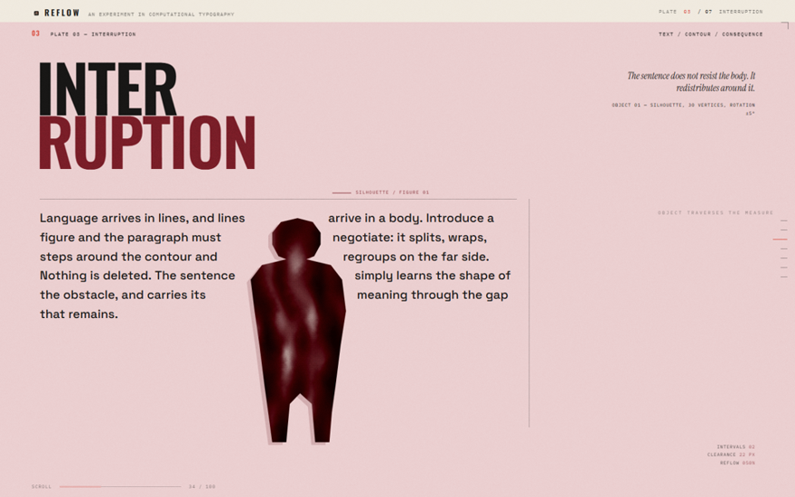
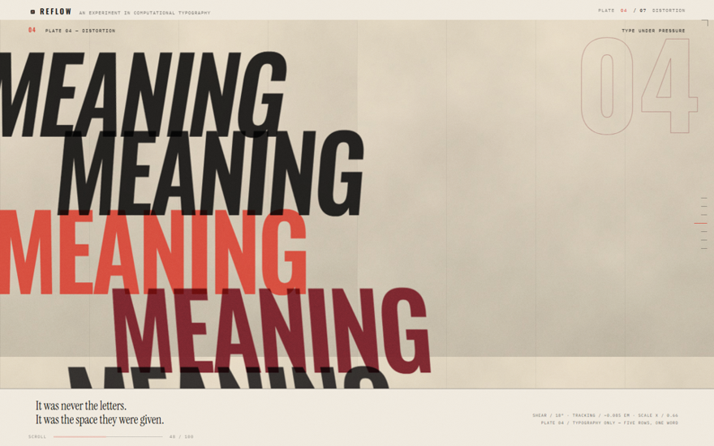
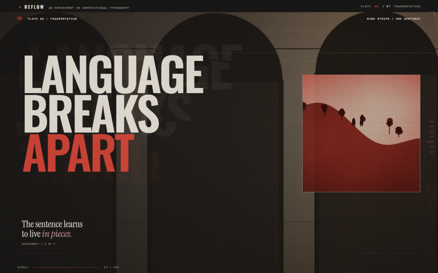
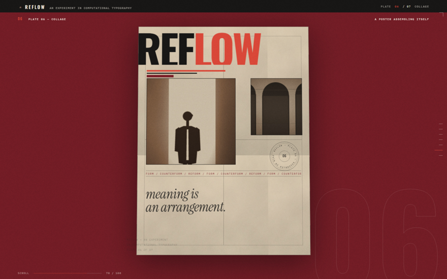
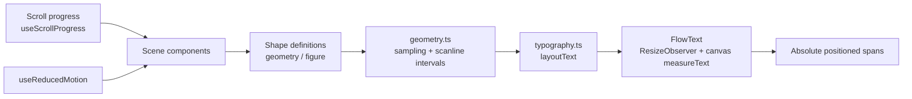

# REFLOW

### The Physical Behaviour of Language

REFLOW is a scrolling web exhibition in seven plates. Each plate takes a piece of writing and treats it as a material with weight, edges and an appetite for space: it expands, gets interrupted, distorts, fragments, and finally composes itself around a single point. One typographic engine drives the whole show.

The project is a creative frontend experiment in **computational typography**: text is measured, positioned and reflowed at runtime around arbitrary shapes, with scroll progress driving the motion of every element.

It asks a simple question — *what happens to a sentence when a body enters the frame?* — and answers it in code: the paragraph is never cut or faded out. It is re-set around the obstacle, line by line, using the free intervals the shape leaves behind.

**Role:** design and engineering, solo build.

---

## Live Demo

**The exhibition is deployed and publicly accessible.**

[](https://reflow-wow.vercel.app/)
[](https://reflow-wow.vercel.app/)

**Live URL:** https://reflow-wow.vercel.app/

> Open it in a desktop browser and scroll slowly. The plates are designed to be read in motion.

---

## Preview

Screenshots are captured from the production build at 1440×900 with `scripts/shoot.mjs` (headless Chrome via the DevTools Protocol), not mocked up.


| Plate 02 — Expansion | Plate 03 — Interruption |
| --- | --- |
|  |  |

| Plate 04 — Distortion | Plate 05 — Fragmentation |
| --- | --- |
|  |  |

| Plate 06 — Collage | Plate 07 — The Composition |
| --- | --- |
|  |  |

---

## Plates

| Plate | Title | What happens |
| ----- | ----- | ------------ |
| 01 | The Specimen | The wordmark at poster scale, with the specimen notes |
| 02 | Expansion | Type pushed past its own measure until the letters part |
| 03 | Interruption | A paragraph reflows live around a drawn figure |
| 04 | Distortion | Perspective and weight bent by scroll |
| 05 | Fragmentation | A sentence cut into strips that reassemble |
| 06 | Collage | Layered sheets, seals and marginalia |
| 07 | The Composition | Every move so far resolved into one layout |

A colophon leaf closes the exhibition and carries the author's signature, set by the same engine.

---

## Features

- **Geometry-aware text layout.** `layoutText` measures words with the Canvas API and fits them into the free intervals left by one or more obstacles, instead of flowing into a plain rectangle.
- **Scanline obstacle sampling.** Shapes (circle, ellipse, rectangle, polygon, organic) are sampled into polygons; horizontal scanlines produce obstructed intervals, which are merged and inverted into available text slots.
- **Conservative line-box clearance.** Each line samples several vertical positions across its line box, so a glyph line clears an obstacle at every sampled height rather than only on its baseline.
- **Word and glyph granularity.** Whole-word layout for paragraphs; per-glyph layout lets a single word part around an obstacle (used by the signature).
- **Scroll-driven composition.** A rAF-throttled hook maps each section's scroll progress to `0..1`, exposing it both as a CSS variable (`--p`) and as React state.
- **Fixed reading interface.** A chrome rail tracks the active plate by viewport midpoint, shows scroll percentage, and supports hash-based deep links with smooth scrolling (auto when reduced motion is requested).
- **Web-font-aware measurement.** The canvas measure cache is cleared and text is re-measured when `document.fonts` settles, so a late font swap cannot leave words overlapping.
- **Responsive adaptation.** Layouts recompute through `ResizeObserver`; type sizes and the silhouette scale adjust to the container (Plate 03 drops to 15px body type on narrow measures). The exhibition is art-directed for desktop first — the densest plates are tighter on a phone than on a wide screen.
- **Reduced-motion support.** `prefers-reduced-motion` is respected by the signature animation and the chrome's scroll behaviour.
- **Accessibility basics.** Sections are labelled, the navigation is keyboard reachable, and decorative layers carry `aria-hidden`.

All of the above are implemented in the repository. The quieter, more experimental behaviours — a per-glyph signature that lets a dot pass through a name, and the ink-misregistration layer in Plate 03 — are built but deliberately understated; they are compositions, not separate product features. Nothing in this README is a claim about unbuilt work.

---

## Tech Stack


- **Languages:** TypeScript, CSS
- **Framework:** React 18
- **Build tool:** Vite 6
- **Styling:** Plain CSS with custom properties (no CSS framework, no component library)
- **Testing:** Vitest in a jsdom environment (10 unit tests over the geometry and typography engines)
- **Type stacks:** Oswald and Archivo Narrow (condensed), Instrument Serif and Bodoni Moda (serif), Space Grotesk (grotesque), IBM Plex Mono (mono) — loaded from Google Fonts
- **Deployment:** Vercel (static build)
- **Runtime services:** None — no API keys, no environment variables, no backend

---

## How It Works

### Architecture



### 1. Text is represented as tokens

`layoutText` splits the input into paragraphs and words. Words wider than the container are broken at grapheme boundaries. In word mode, tokens are whole words; in glyph mode, each character becomes a token carrying its index in the run.

### 2. Obstacles become intervals

`availableSlotsForShapes` samples each `Shape` into a polygon (circle, ellipse, rectangle with optional corner radius, polygon, or organic noise). For a given line `y`, `scanlineObstructed` intersects the polygon edges with that horizontal line and returns the obstructed `x` ranges. These are padded, merged, and inverted against the container width `W` to produce the free slots for that line.

### 3. Words are fitted into slots

For each line, the engine walks the available slots left to right, placing words (with inter-word spacing) until a word no longer fits, then moves to the next slot. If no slot on the current line can hold the word, the line is finalised and the process retries on the next line. Empty or too-narrow lines advance by one line height so an obstacle never stalls the layout.

### 4. Scroll drives everything

`useScrollProgress` computes a normalised progress value from the section's `getBoundingClientRect` and its height relative to the viewport. It writes `--p` to the section element and throttles React state updates to changes above `0.0015`. Scenes read `progress` and map it through eased ramps (`ss`, `range`) into transforms, opacity and clip-paths. Plate 03 is the clearest case: the figure's centre is driven by `W * (0.9 - 0.72 * ss(p, 0.05, 0.95))`, and the paragraph is re-laid out at every step of that traversal.

### 5. Rendering

`FlowText` measures its container with a `ResizeObserver`, runs `layoutText`, and renders one absolutely positioned `<span>` per segment, preserving the computed `x` and `y`. The signature uses the same engine in glyph mode and writes glyph positions directly to the DOM inside a `requestAnimationFrame` loop gated by an `IntersectionObserver`, avoiding per-frame React renders.

---

## Setup and Run Locally

**Prerequisites:** Node.js 20 or newer.

```bash
git clone https://github.com/LikhitCodezz/Reflow.git
cd Reflow
npm install
npm run dev
```

The dev server prints a local URL (usually `http://localhost:5173`).

### Scripts

| Command | Description |
| ------- | ----------- |
| `npm run dev` | Start the Vite dev server with hot reload |
| `npm run build` | Type-check, then build to `dist/` |
| `npm run preview` | Serve the production build locally |
| `npm test` | Run the Vitest suite |
| `npm run typecheck` | Type-check without emitting |

No environment variables are required.

---

## Deployment

The site is a static build, so any static host works. It is deployed on **Vercel** at https://reflow-wow.vercel.app/.

On Vercel, import the repository and accept the detected settings: framework **Vite**, build command `npm run build`, output directory `dist`.

---

## Project Structure

```
src/
  App.tsx            composition of all plates
  main.tsx           entry point
  scenes/            one file per plate, plus the colophon leaf
  components/        FlowText, SignatureMark, Chrome, PlateHead
  hooks/             useScrollProgress, useElementSize, useReducedMotion
  lib/               geometry, typography, figure, plates, anim
  styles/            global.css — colour, type scale, every plate's layout
  test/              Vitest setup
public/
  images/            editorial photography and paper/ink textures
  favicon.png
docs/
  screenshots/       README screenshots
scripts/             asset generation and screenshot helpers
```

Core implementation lives in `src/lib/geometry.ts` and `src/lib/typography.ts`, with `src/components/FlowText.tsx` as the rendering boundary.

---

## What I Learned

### Dynamic text layout
- Measuring text with the Canvas API (`measureText`) and building a keyed cache (`family|size|weight|letterSpacing|text`) with a size cap, instead of re-measuring every word on every scroll frame.
- Treating text as tokens that must be fitted into variable-width intervals instead of flowing into a fixed column.
- Why a cache becomes *wrong* rather than merely stale when a web font swaps in: the fallback face's advance widths are cached under the same key, so layout has to be invalidated, not just recomputed.
- Adding `letterSpacing` to the canvas context so measured widths match what CSS renders.
- Breaking long words at grapheme boundaries (`Array.from(word)`, not `split('')`) so a single token cannot overflow the measure.
- Choosing a minimum slot width as a function of font size — `2.6em` for whole words, `0.5em` for glyphs — to stop orphan words from being placed in slivers beside a silhouette.
- Aligning groups per slot (left, centre, right, justify), justifying only non-final lines, and re-distributing free space between words rather than stretching glyphs.

### Browser rendering and layout
- Using `ResizeObserver` on the text stage so layout follows the element's own box, not just the window.
- Reading `clientWidth`/`getBoundingClientRect` once per frame in a rAF callback, and keeping measurement out of React's render phase.
- Writing glyph positions straight to `style.transform` inside the signature loop and skipping unchanged positions with a quantised key — an escape hatch from React's render cycle for high-frequency updates.
- Gating animation with `IntersectionObserver` (`rootMargin: '12% 0px'`) so off-screen plates cost nothing.
- Recognising that this layout is *manual* typesetting: the browser's own line-breaking is bypassed, so every word's x/y is computed and no CSS `text-wrap` behaviour applies.

### Scroll-driven interactions
- Mapping scroll position to a normalised `0..1` value per section: `p = -rect.top / (rect.height - innerHeight)`, clamped.
- Publishing progress as a CSS custom property (`--p`) as well as React state, so CSS and JS can read the same value.
- Throttling: one rAF per scroll burst, plus an epsilon (`0.0015`) on state so React re-renders only when progress visibly changes.
- Using `{ passive: true }` scroll listeners so the browser never waits on the handler for scrolling.
- Easing ramps (`smoothstep`, `range`, `clamp`, `lerp`) so linear scroll produces motion with weight and settles at both ends.
- Coordinating a pinned section: each plate is `250vh`–`330vh` tall while `.scene__stage` is `position: sticky; top: 0; height: 100vh`, so the composition stays on screen while progress advances.

### Animation and interaction
- Coordinating many elements (transforms, opacity, `clip-path`, background position, letter-spacing) from a single progress value, so the whole plate stays in sync by construction.
- Damped follow for the signature dot (`shown += (target - shown) * 0.06`), which gives it mass and lets it come to rest after scrolling stops.
- Second-order drift (`sin`/`cos` on elapsed time) layered on top of the scroll-driven position, so the mark never looks mechanically frozen.
- Compositor-friendly properties: `translate3d`, `scale`, `rotate`, `opacity` and `clip-path`, with the CSS transition explicitly disabled on JS-owned values so the two never fight.
- Respecting `prefers-reduced-motion` by switching to a composed static signature and disabling smooth scrolling.

### Responsive design
- Recomputing font size from the container width (`clamp(w * 0.24, 44, 150)` for the signature) rather than media queries alone.
- Scaling a fixed 30-vertex silhouette to the stage height (`H * 0.98 / FIGURE_HEIGHT`) so the figure keeps its proportions on any viewport.
- Falling back from `22px` to `15px` body type below a `520px` measure in Plate 03, where a desktop size would run past the stage.
- Re-running the whole layout automatically on width change, and using `stageHeight` to keep the stage's reserved height stable while text reflows.
- Handling the case where fonts, not the viewport, are what changed — the layout is also keyed on a `fontEpoch` counter.

### Debugging and problem-solving
- **Descenders colliding with the silhouette.** A single baseline sample lets the bottom of a line clip a shape, so the implementation samples five heights across the line box (`y + 1`, `25%`, `50%`, `75%`, `y + lh - 1`) and unions the obstructed intervals — conservative, so the text clears the figure at every height.
- **A line that cannot make progress.** If every slot was too narrow, the fitting loop could spin. Fixed by detecting no-progress iterations and advancing one line height, with a guard counter as a backstop.
- **Late web fonts overlapping words.** Text measured against fallback metrics stayed at those positions after the real face loaded. Fixed by clearing the cache and bumping `fontEpoch` on `document.fonts.ready` and the `loadingdone` event.
- **Orphan words beside a shape.** Allowing any positive slot produced single words stacked in slivers. Fixed with a font-size-relative minimum slot width.
- **Justified last lines.** Justification looked broken on a final line, so it is excluded by an `isLastLine` flag.
- **Testing layout without a browser.** The canvas is mocked in `src/test/setup.ts` with deterministic width maths, which makes pure geometry and wrapping logic testable in jsdom.

What this changed in how I work: I now treat text layout as an algorithm with inputs, invariants and failure cases — and I test the engine separately from the composition that uses it.

---

## Future Improvements

- Hyphenation and kerning-aware measurement for denser, more even paragraphs.
- Additional obstacle types and animated shapes that move independently of scroll.
- Touch-specific interaction modes and mobile-first layout recalculations.
- Further performance work during continuous scrolling (profiling and memoisation of shape sampling).
- Accessibility improvements: full keyboard traversal of the exhibition, focus management when plates change, and a linear screen-reader reading order for the composed text.
- Additional plates exploring other typographic behaviours.

---

## Skills Demonstrated

- Creative frontend engineering
- Computational typography and dynamic text layout
- Canvas-based text measurement and caching
- Polygon sampling and scanline interval calculation
- DOM measurement and `ResizeObserver`
- Scroll-driven animation and `requestAnimationFrame`
- React, TypeScript and Vite
- Responsive, reduced-motion-aware UI
- Unit testing pure layout logic with Vitest
- Scroll progress mapping and eased interpolation
- `prefers-reduced-motion` and basic ARIA hygiene
- Static deployment on Vercel

---

## Verification

- `npm test` — 10 tests across `geometry.test.ts` and `typography.test.ts` pass.
- `npm run typecheck` — TypeScript strict mode passes.
- `npm run build` — production build succeeds (`dist/`).
- Live deployment returns `HTTP 200` from Vercel at https://reflow-wow.vercel.app/ with title `REFLOW — The Physical Behaviour of Language`.
- README screenshots are committed under `docs/screenshots/` and are captured from this codebase.

_Not verified:_ Vercel preview deployments and any custom-domain configuration, since no `vercel.json` or domain configuration exists in the repository.

---

## Colophon

Designed and built by Likhit Choudhary. Type stacks include Oswald and Archivo Narrow, Instrument Serif and Bodoni Moda, Space Grotesk, and IBM Plex Mono, served from Google Fonts. Imagery is original two-ink duotones.
