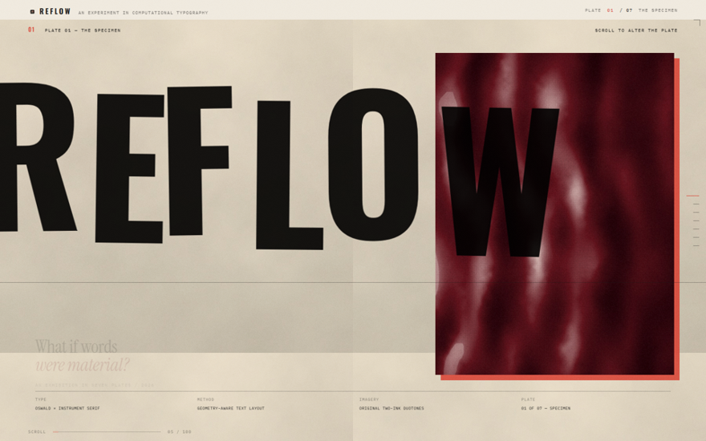
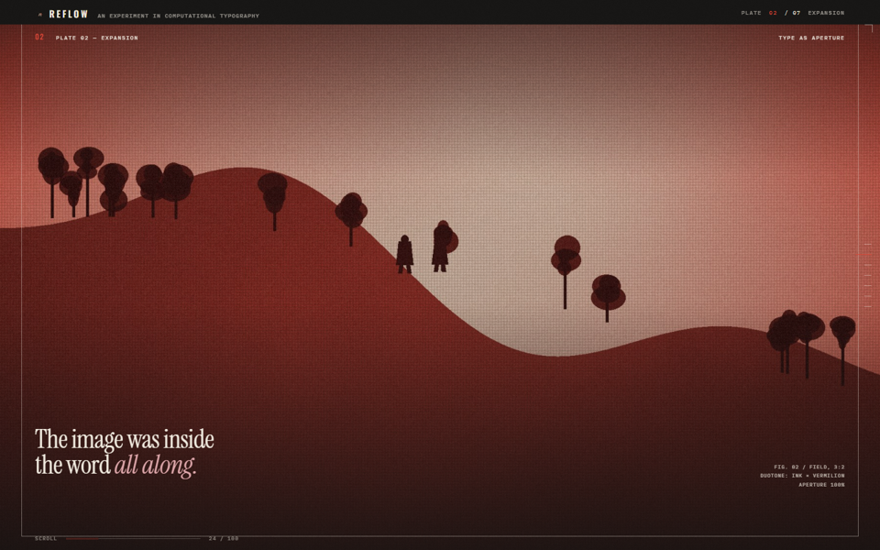
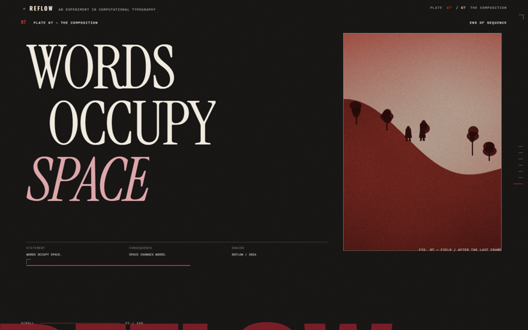
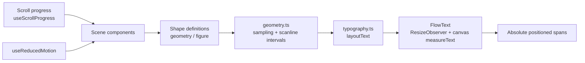

# REFLOW

### The Physical Behaviour of Language

REFLOW is a scrolling web exhibition in seven plates. Each plate takes a piece of writing and treats it as a material with weight, edges and an appetite for space: it expands, gets interrupted, distorts, fragments, and finally composes itself around a single point. One typographic engine drives the whole show.

The project is a creative frontend experiment in **computational typography**: text is measured, positioned and reflowed at runtime around arbitrary shapes, with scroll progress driving the motion of every element.

---

## 🟢 Live Demo

**The exhibition is deployed and publicly accessible.**

[](https://reflow-wow.vercel.app/)
[](https://reflow-wow.vercel.app/)

**Live URL:** https://reflow-wow.vercel.app/

> Open it in a desktop browser and scroll slowly. The plates are designed to be read in motion.

---

## Preview



| Plate 02 — Expansion | Plate 03 — Interruption |
| --- | --- |
|  |  |

| Plate 04 — Distortion | Plate 05 — Fragmentation |
| --- | --- |
|  |  |

| Plate 06 — Collage | Plate 07 — The Composition |
| --- | --- |
|  |  |

---

## Plates

| Plate | Title | What happens |
| ----- | ----- | ------------ |
| 01 | The Specimen | The wordmark at poster scale, with the specimen notes |
| 02 | Expansion | Type pushed past its own measure until the letters part |
| 03 | Interruption | A paragraph reflows live around a drawn figure |
| 04 | Distortion | Perspective and weight bent by scroll |
| 05 | Fragmentation | A sentence cut into strips that reassemble |
| 06 | Collage | Layered sheets, seals and marginalia |
| 07 | The Composition | Every move so far resolved into one layout |

A colophon leaf closes the exhibition and carries the author's signature, set by the same engine.

---

## Features

- **Geometry-aware text layout.** `layoutText` measures words with the Canvas API and fits them into the free intervals left by one or more obstacles, instead of flowing into a plain rectangle.
- **Scanline obstacle sampling.** Shapes (circle, ellipse, rectangle, polygon, organic) are sampled into polygons; horizontal scanlines produce obstructed intervals, which are merged and inverted into available text slots.
- **Conservative line-box clearance.** Each line samples several vertical positions across its line box, so a glyph line clears an obstacle at every sampled height rather than only on its baseline.
- **Word and glyph granularity.** Whole-word layout for paragraphs; per-glyph layout lets a single word part around an obstacle (used by the signature).
- **Scroll-driven composition.** A rAF-throttled hook maps each section's scroll progress to `0..1`, exposing it both as a CSS variable (`--p`) and as React state.
- **Fixed reading interface.** A chrome rail tracks the active plate by viewport midpoint, shows scroll percentage, and supports hash-based deep links with smooth scrolling (auto when reduced motion is requested).
- **Web-font-aware measurement.** The canvas measure cache is cleared and text is re-measured when `document.fonts` settles, so a late font swap cannot leave words overlapping.
- **Responsive adaptation.** Layouts recompute through `ResizeObserver`; font sizes adjust for narrow measures (e.g. Scene 03).
- **Reduced-motion support.** `prefers-reduced-motion` is respected by the signature animation and the chrome's scroll behaviour.
- **Accessibility basics.** Sections are labelled, the navigation is keyboard reachable, and decorative layers carry `aria-hidden`.

---

## Tech Stack


- **Languages:** TypeScript, CSS
- **Framework:** React 18
- **Build tool:** Vite 6
- **Styling:** Plain CSS with custom properties (no CSS framework, no component library)
- **Testing:** Vitest in a jsdom environment
- **Fonts:** Oswald, Instrument Serif, Bodoni Moda, Space Grotesk, IBM Plex Mono, Archivo Narrow (Google Fonts)
- **Deployment:** Vercel (static build)
- **Runtime services:** None

---

## How It Works

### Architecture



### 1. Text is represented as tokens

`layoutText` splits the input into paragraphs and words. Words wider than the container are broken at grapheme boundaries. In word mode, tokens are whole words; in glyph mode, each character becomes a token carrying its index in the run.

### 2. Obstacles become intervals

`availableSlotsForShapes` samples each `Shape` into a polygon (circle, ellipse, rectangle with optional corner radius, polygon, or organic noise). For a given line `y`, `scanlineObstructed` intersects the polygon edges with that horizontal line and returns the obstructed `x` ranges. These are padded, merged, and inverted against the container width `W` to produce the free slots for that line.

### 3. Words are fitted into slots

For each line, the engine walks the available slots left to right, placing words (with inter-word spacing) until a word no longer fits, then moves to the next slot. If no slot on the current line can hold the word, the line is finalised and the process retries on the next line. Empty or too-narrow lines advance by one line height so an obstacle never stalls the layout.

### 4. Scroll drives everything

`useScrollProgress` computes a normalised progress value from the section's `getBoundingClientRect` and its height relative to the viewport. It writes `--p` to the section element and throttles React state updates to changes above `0.0015`. Scenes read `progress` and map it through eased ramps (`ss`, `range`) into transforms, opacity and clip-paths.

### 5. Rendering

`FlowText` measures its container with a `ResizeObserver`, runs `layoutText`, and renders one absolutely positioned `<span>` per segment, preserving the computed `x` and `y`. The signature uses the same engine in glyph mode and writes glyph positions directly to the DOM inside a `requestAnimationFrame` loop gated by an `IntersectionObserver`, avoiding per-frame React renders.

---

## Setup and Run Locally

**Prerequisites:** Node.js 20 or newer.

```bash
git clone https://github.com/LikhitCodezz/Reflow.git
cd Reflow
npm install
npm run dev
```

The dev server prints a local URL (usually `http://localhost:5173`).

### Scripts

| Command | Description |
| ------- | ----------- |
| `npm run dev` | Start the Vite dev server with hot reload |
| `npm run build` | Type-check, then build to `dist/` |
| `npm run preview` | Serve the production build locally |
| `npm test` | Run the Vitest suite |
| `npm run typecheck` | Type-check without emitting |

No environment variables are required.

---

## Deployment

The site is a static build, so any static host works. It is deployed on **Vercel** at https://reflow-wow.vercel.app/.

On Vercel, import the repository and accept the detected settings: framework **Vite**, build command `npm run build`, output directory `dist`.

---

## Project Structure

```
src/
  App.tsx            composition of all plates
  main.tsx           entry point
  scenes/            one file per plate, plus the colophon leaf
  components/        FlowText, SignatureMark, Chrome, PlateHead
  hooks/             useScrollProgress, useElementSize, useReducedMotion
  lib/               geometry, typography, figure, plates, anim
  styles/            global.css — colour, type scale, every plate's layout
  test/              Vitest setup
public/
  images/            editorial photography and paper/ink textures
  favicon.png
docs/
  screenshots/       README screenshots
scripts/             asset generation and screenshot helpers
```

Core implementation lives in `src/lib/geometry.ts` and `src/lib/typography.ts`, with `src/components/FlowText.tsx` as the rendering boundary.

---

## What I Learned

### Dynamic text layout
- Measuring text with the Canvas API (`measureText`) and why a cached fallback metric becomes wrong after a web font swaps in.
- Treating text as tokens that must be fitted into variable-width intervals instead of a fixed column.
- Breaking long words at grapheme boundaries so a single long token cannot overflow the measure.
- Keeping words whole in paragraph mode while allowing per-glyph layout when a shape must split a single word.
- Aligning groups per slot (left, centre, right, justify) and not justifying the last line.

### Browser rendering and layout
- Using `ResizeObserver` to recompute layout when the container changes, rather than listening to `resize` alone.
- Combining DOM measurement (`getBoundingClientRect`, `clientWidth`) with React state carefully to avoid layout thrash.
- Writing positions directly to the DOM inside animation loops, and gating that work behind an `IntersectionObserver`.
- Clearing and rebuilding a measurement cache in response to font-loading events.

### Scroll-driven interactions
- Mapping scroll position to a normalised `0..1` progress value per section.
- Throttling state updates with a small epsilon so React does not re-render on every pixel of scroll.
- Using `requestAnimationFrame` for scroll handlers and `{ passive: true }` listeners.
- Easing ramps (`smoothstep`, `range`, `clamp`, `lerp`) to turn linear progress into motion with weight.
- Keeping CSS transforms and clip-paths on the compositor-friendly properties.

### Animation and interaction
- Coordinating many elements (transforms, opacity, clip-path) from a single progress value.
- Damped motion for the signature dot so it has mass and settles after scrolling stops.
- Respecting `prefers-reduced-motion` by switching to a static composition.

### Responsive design
- Recomputing font sizes and layout for narrow measures.
- Re-running layout automatically when the container width changes.
- Maintaining readable typography while the composition scales.

### Debugging and problem-solving
- A glyph line only clearing an obstacle on its baseline left descenders colliding with the shape; fixed by sampling several heights across the line box.
- Late font loading leaving words slightly overlapped; fixed by re-measuring on `document.fonts.ready` and `loadingdone`.
- A word wider than every slot stalling the layout; fixed by finalising the line and retrying on the next one.
- Avoiding per-frame React renders in the signature by mutating span transforms directly.

---

## Future Improvements

- Hyphenation and kerning-aware measurement for denser, more even paragraphs.
- Additional obstacle types and animated shapes that move independently of scroll.
- Touch-specific interaction modes and mobile-first layout recalculations.
- Further performance work during continuous scrolling (profiling and memoisation of shape sampling).
- Accessibility improvements: keyboard navigation between plates, screen-reader-friendly reading order, focus management.
- Additional plates exploring other typographic behaviours.

---

## Skills Demonstrated

- Creative frontend engineering
- Computational typography and dynamic text layout
- Canvas-based text measurement and caching
- Polygon sampling and scanline interval calculation
- DOM measurement and `ResizeObserver`
- Scroll-driven animation and `requestAnimationFrame`
- React, TypeScript and Vite
- Responsive, reduced-motion-aware UI
- Unit testing pure layout logic with Vitest
- Static deployment on Vercel

---

## Colophon

Designed and built by Likhit Choudhary. Typefaces in use are Oswald, Instrument Serif, Bodoni Moda, Space Grotesk, IBM Plex Mono and Archivo Narrow, served from Google Fonts. Imagery is original two-ink duotones.
